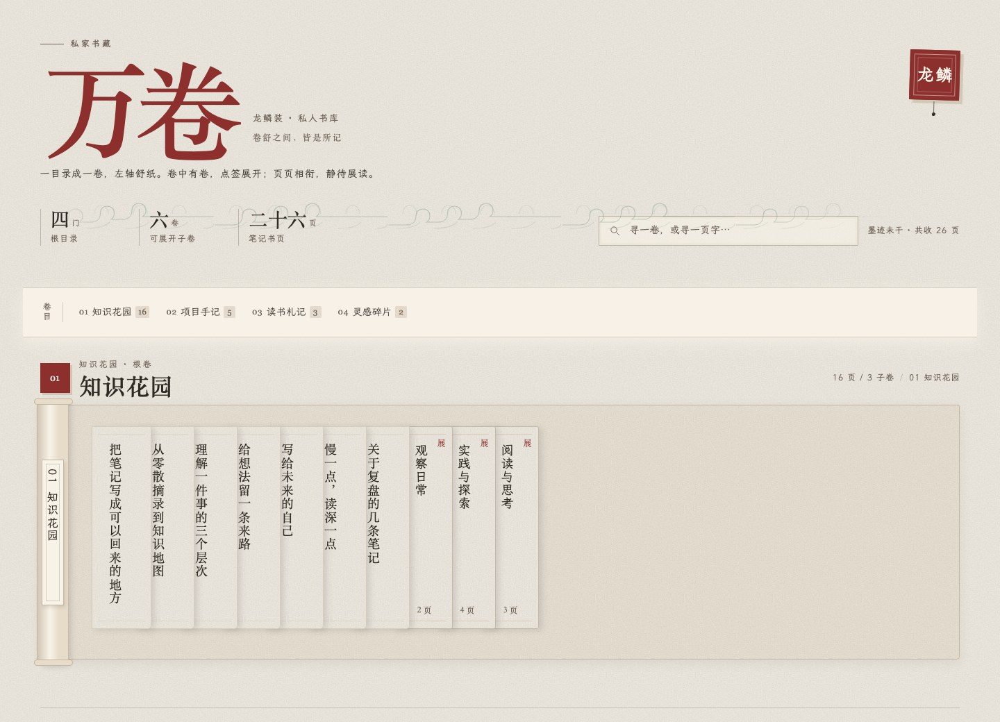
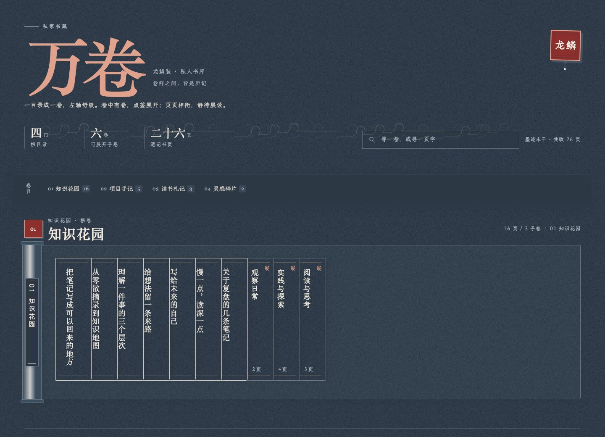
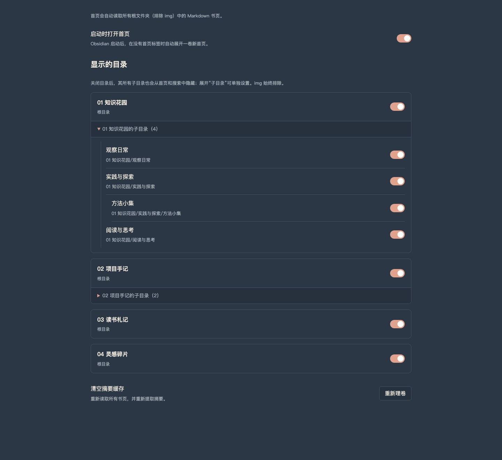

# 万卷龙鳞 · Dragon Scroll Home

以古籍「龙鳞装」为灵感的 Obsidian 首页插件，商店名称为 **Dragon Scroll Home**。每个目录是一卷书，每篇笔记是一张书页；翻卷、展页，在纸面上浏览自己的知识库。

建议与宋韵主题共同使用，[宋韵](https://github.com/jackyoung022/Obsidian-SongStyle)



## 功能

- **目录成卷**：每个根目录对应一个卷轴，左侧轴心贴竖排目录签，纸面向右舒展。
- **书页预览**：默认只露竖排标题；鼠标悬停或键盘聚焦后，向右展开摘要。文字从上到下、从右到左，自然换列。
- **卷中有卷**：子目录与文件页并排，点击后在卷签左侧展开。支持两层子卷，再深的笔记合入第二层并标明来源目录。
- **点签收卷**：再次点击子卷签，或点击展开子卷的轴心头部、目录名，即可收起当前卷。
- **选择显示范围**：根目录和子目录都可单独开关。设置页按父目录分组，隐藏的目录不会出现在首页或搜索中。
- **快速检索**：搜索文件标题、摘要和路径，匹配的子卷自动展开；`Esc` 清空搜索。
- **横向浏览**：触摸板横移、横向滚动或鼠标拖拽。父卷与子卷各自滚动；触屏先点展开摘要，再点打开笔记。
- **本地运行**：不调用 AI 或外部服务，不上传笔记，也不修改笔记正文。目录变动后自动更新，切回首页时刷新已修改的摘要。


## 页面预览

### 深色纸面

浅色使用暖宣与墨色，深色使用黛笺与米白。安装「宋韵·清和」主题时直接继承其颜色和纸纹；使用其他主题时采用内置的宋韵浅深色后备样式，**不要求安装指定主题**。



### 向左展开子卷

子卷留在父卷的同一横排内展开，不打开新页面。竖排卷签仍在右侧，内容向左舒展。


### 悬停查看摘要

书页轻轻打开，摘要沿竖排方向自然续列。点击书页会在 Obsidian 新标签页打开对应笔记；`Alt` 加点击使用分栏。


### 目录显示设置

每个父目录与它的子目录开关位于同一分组内。关闭父目录会隐藏整棵目录分支，并暂停其下级开关；重新开启后保留原有的子目录选择。



## 安装

目前通过本仓库的 Release 手动安装，尚未上架 Obsidian 社区插件目录。

1. 打开 [最新 Release](https://github.com/jackyoung022/Obsidian-WJLL-plugin/releases/latest)，下载 `dragon-scroll-home-版本号.zip`。
2. 解压后，将整个 `dragon-scroll-home` 文件夹放入你的库：

   ```text
   你的笔记库/
   └── .obsidian/
       └── plugins/
           └── dragon-scroll-home/
               ├── main.js
               ├── manifest.json
               ├── styles.css
               └── LICENSE
   ```

3. 重新加载 Obsidian，在「设置 → 第三方插件」中启用「Dragon Scroll Home」。若已开启受限模式，需要先允许社区插件。可参考 [Obsidian 官方插件说明](https://help.obsidian.md/Extending+Obsidian/Community+plugins)。
4. 点击侧栏卷轴图标，或在命令面板运行「Dragon Scroll Home：打开龙鳞首页」。

也可分别下载 Release 中的 `main.js`、`manifest.json`、`styles.css` 和 `LICENSE`，放入同一插件目录。不要只下载 GitHub 自动生成的源码 ZIP 后直接当插件目录使用。

**升级**：停用插件，用新版文件覆盖同名文件，再重新启用。保留本地 `data.json`，即可保留目录开关等设置。卸载时停用插件并删除插件文件夹即可，笔记不受影响。

## 使用与设置

| 入口 | 用途 |
| --- | --- |
| 侧栏卷轴图标 /「打开龙鳞首页」命令 | 打开或定位已有首页标签 |
| 顶部卷目 | 定位对应根目录卷轴 |
| 书页标题 | 悬停展开摘要，点击打开笔记 |
| 子目录竖签 | 在左侧展开或收起子卷 |
| 展开子卷的轴心头部 / 目录名 | 收起该子卷，父卷保持展开 |
| 搜索框 / `Esc` | 检索标题、摘要、路径 / 清空搜索 |
| 设置 → Dragon Scroll Home → 显示的目录 | 保存根目录和子目录的显示选择 |
|「重整龙鳞首页」命令 / 清空摘要缓存 | 重新提取笔记摘要 |

「启动时打开首页」默认开启，可在插件设置中关闭。目录开关即时保存、即时刷新。

## 目录与摘要规则

- 仅读取根目录文件夹中的 Markdown 笔记，暂不展示库根目录直接存放的散页。空目录保留空卷。
- 所有层级中名为 `img` 的目录以及隐藏目录始终排除。其他目录可用设置开关控制。
- 同一卷的笔记按最近修改时间排序。
- 摘要优先读取 frontmatter 的 `description`、`summary`、`excerpt` 或 `摘要`。没有这些字段时，提取正文第一段可读文字；显示时会截取为短摘要。
- Excalidraw 笔记以画布说明显示；代码为主或没有正文的文件有相应占位提示。

例如：

```yaml
---
title: 写给未来的自己
summary: 把此刻的思考留成线索，让未来的自己能重新走进这段理解。
---
```

嵌套层级为「根卷 → 第一层子卷 → 第二层子卷」。更深目录不会再生成卷轴，其笔记会保留在第二层子卷内，并显示原目录路径。

## 兼容性

- `manifest.json` 声明最低 Obsidian 版本为 **1.14.4**；目前在 **macOS / Obsidian 1.14.4** 上验证过实际界面。
- 包含触屏与窄分栏适配，但尚未完成 iOS / Android 真机验证。
- 不依赖 Dataview、Homepage 插件或远程字体。优先使用本机宋体、楷体等字体，缺失时使用系统后备字体。
- 首页采用自己的宋韵纸面；它会跟随浅色/深色模式，不会强制更改全局主题。

## 开发与打包

插件由原生 JavaScript 和 CSS 构成，无运行时 npm 依赖，也无需编译。

```bash
git clone https://github.com/jackyoung022/Obsidian-WJLL-plugin.git
cd Obsidian-WJLL-plugin
npm test
python3 scripts/package.py
```

开发检查需要 Node.js 18+，打包需要 Python 3。生成的 `dist/` 包含安装 ZIP、独立安装文件与 `SHA256SUMS.txt`。打包脚本只允许四个文件进入安装包，个人 `data.json`、笔记库与开发截图不在其中。

重生成示例截图及浏览器交互检查：

```bash
python3 -m pip install playwright
python3 -m playwright install chromium
python3 scripts/render_screenshots.py
```

示例内容位于 `docs/demo/content.json`，渲染使用实际的 `main.js` 和 `styles.css`。浏览器适配层仅用于文档截图，不随插件安装。

## 反馈与许可

问题和建议请提交到 [Issues](https://github.com/jackyoung022/Obsidian-WJLL-plugin/issues)，说明 Obsidian 版本、操作系统和复现步骤。

本项目采用 [MIT License](LICENSE)，允许使用、修改和分发；分发时请保留版权及许可声明。协议原文可参见 [Open Source Initiative](https://opensource.org/license/mit)。
